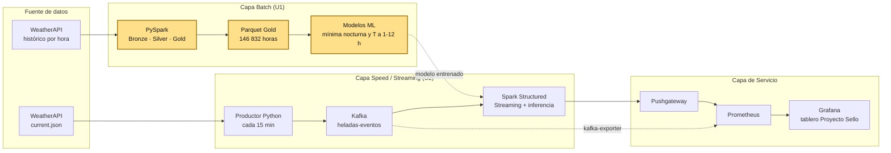

# 02 · Dominio del proyecto

## Nombre del proyecto

**Anticipación de heladas en Juliaca**

## Problema o necesidad que resuelve

Juliaca, en el altiplano andino (>3 800 msnm), está expuesta a heladas nocturnas que afectan directamente la producción agrícola local (papa, quinua, cebada). Cubrir los cultivos a tiempo cuesta mucho menos que perderlos, pero no existe una herramienta accesible que combine el histórico climático con lecturas en tiempo real para anticipar la helada y actuar (proteger cultivos, emitir alertas).

## Dominio de datos

Meteorología aplicada a la agricultura y a la gestión de riesgo — variables horarias de temperatura, punto de rocío, humedad y nubosidad.

!!! question "Pregunta central de negocio"
    ¿Cómo anticipar las heladas (temperatura ≤ 0 °C) en Juliaca para apoyar decisiones agrícolas y de gestión de riesgo local?

## Usuarios / actores principales

Agricultores y asociaciones agrarias de la zona; gestores de riesgo local; y, como actor automatizado, el propio sistema de alertas que consume las salidas del pipeline.

## Arquitectura Big Data

LAMBDA

El proyecto necesita dos vistas complementarias sobre el mismo origen de datos:

- **(a) Vista histórica batch** — describe el pasado, aprende la estacionalidad y entrena modelos que se calculan una vez por corrida.
- **(b) Vista en tiempo real** — cada lectura nueva llega por Kafka y se convierte en una predicción a 1 hora.

!!! note "¿Por qué no Kappa?"
    Kappa no se justifica porque el reprocesamiento de 16 años de histórico horario (146 832 registros) es más eficiente como batch por lotes que como replay de un log de eventos único, y porque el curso pide explícitamente ambas capas (U1 batch + U2 streaming) tratadas de forma distinta.

*Figura 1. Arquitectura Lambda del proyecto — la capa batch (naranja) se construyó en la Unidad I; la capa speed/streaming y la capa de servicio son el contenido de la Unidad II.*

## Fuentes de datos

=== "Batch"

    **WeatherAPI · histórico** — una lectura por hora de Juliaca desde 2010-01-01 hasta 2026-10-01 (146 832 registros). Variables usadas: `temperatura`, `puntoRocio`, `humedad`, `nubosidad`. El histórico de la API existe solo por hora, por eso el modelo se entrena y evalúa a frecuencia horaria. Nada posterior al 1 de octubre de 2026.

=== "Streaming"

    **WeatherAPI · `current.json`**, consultada por un productor Python cada 15 minutos y publicada como evento `clima.lectura` en el tópico Kafka `heladas-eventos` (key = ciudad). Es el mismo origen físico que el batch, con lecturas reales: la API actualiza su observación cada ~15 minutos, por lo que varios eventos seguidos pueden compartir el mismo `observadoEn`.

## ¿Continúa un proyecto anterior o es un dominio nuevo?

Es un proyecto propio, rediseñado desde cero siguiendo las guías del curso: una sola dimensión (heladas), una sola fuente (WeatherAPI) y una arquitectura Lambda completa de la ingesta al tablero.
