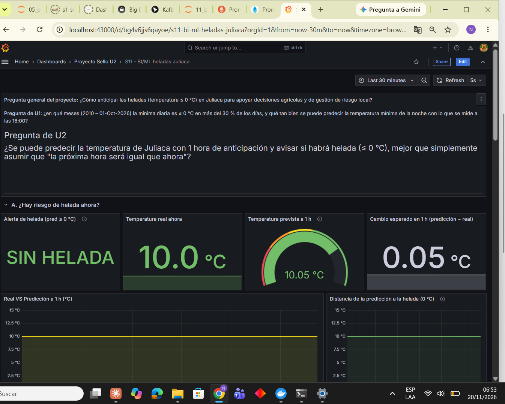
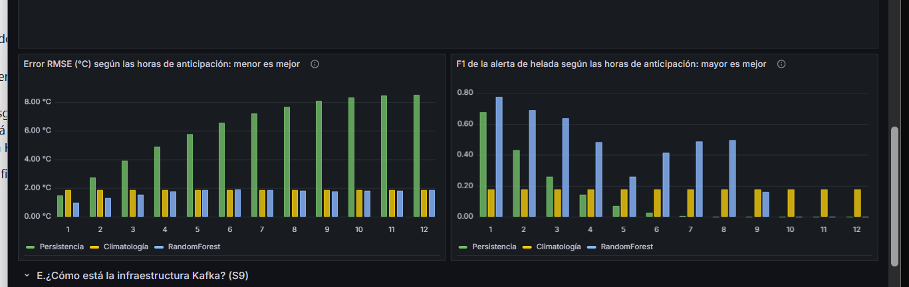
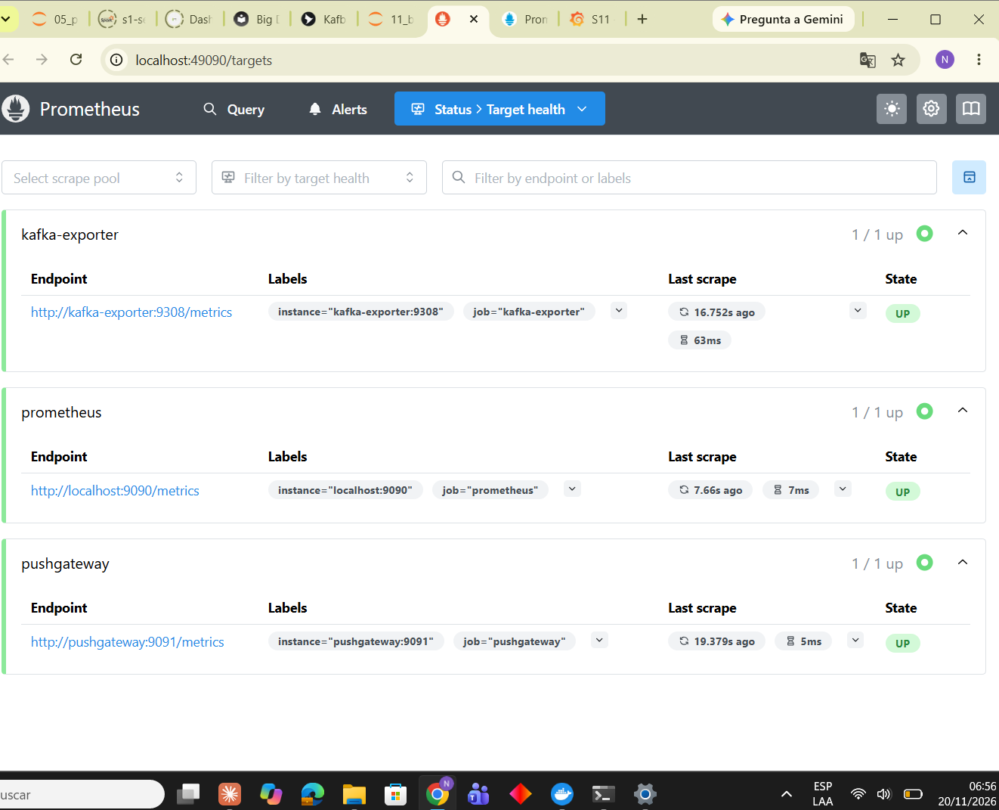
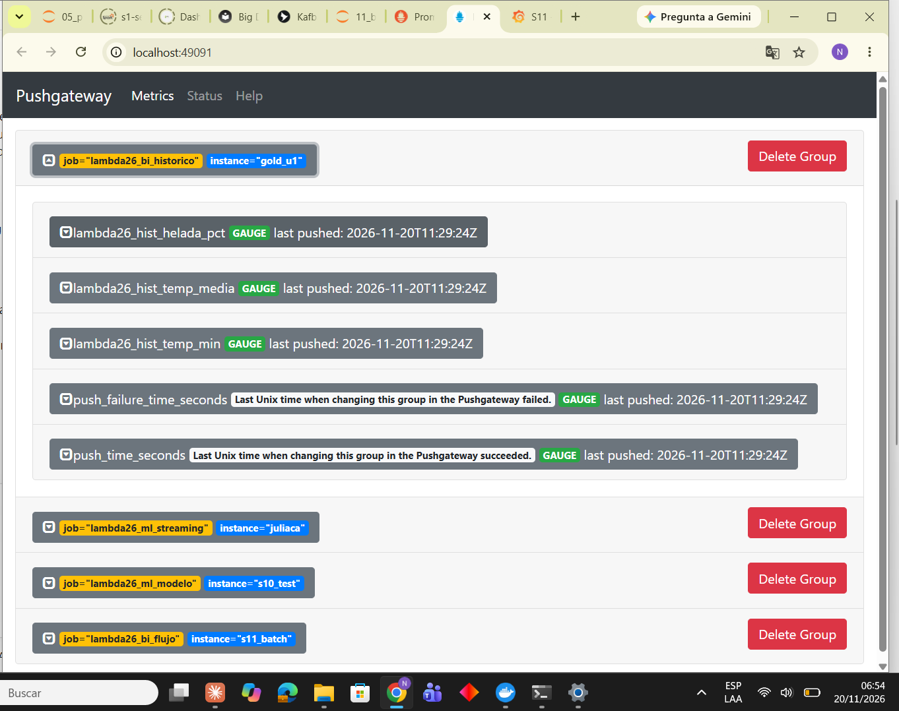
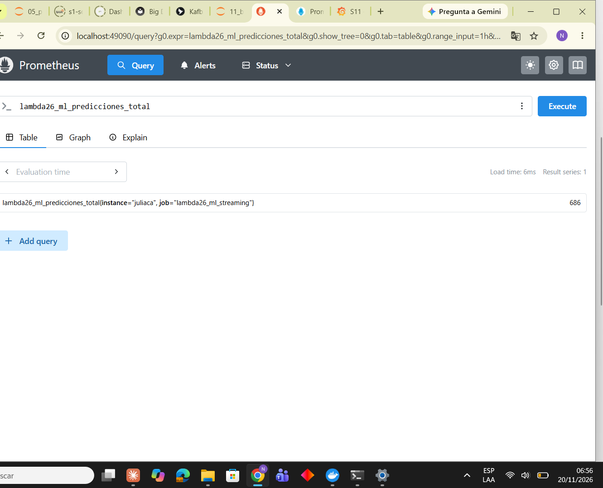
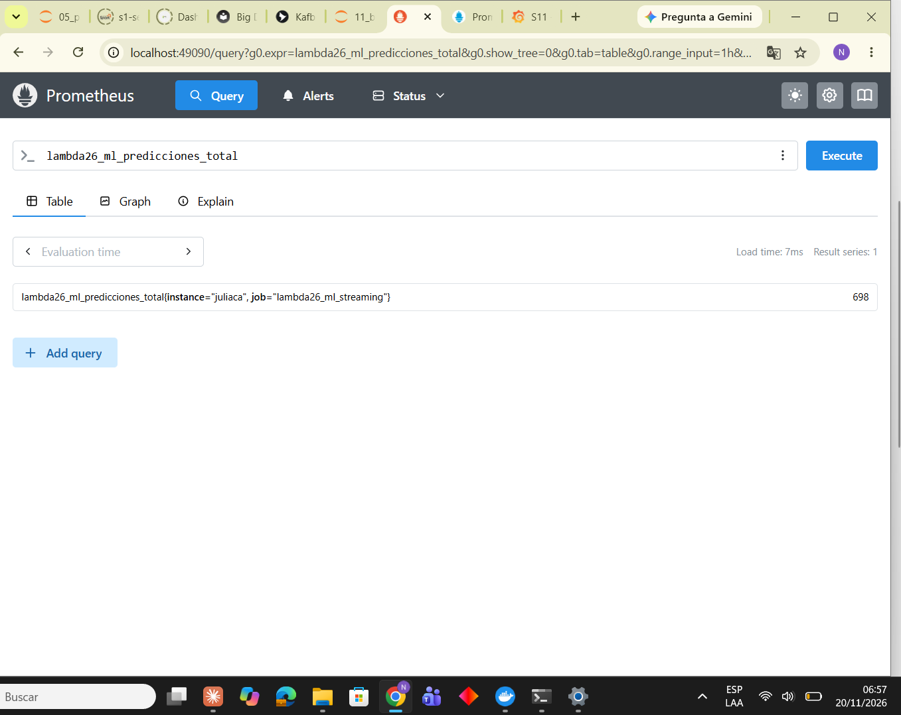
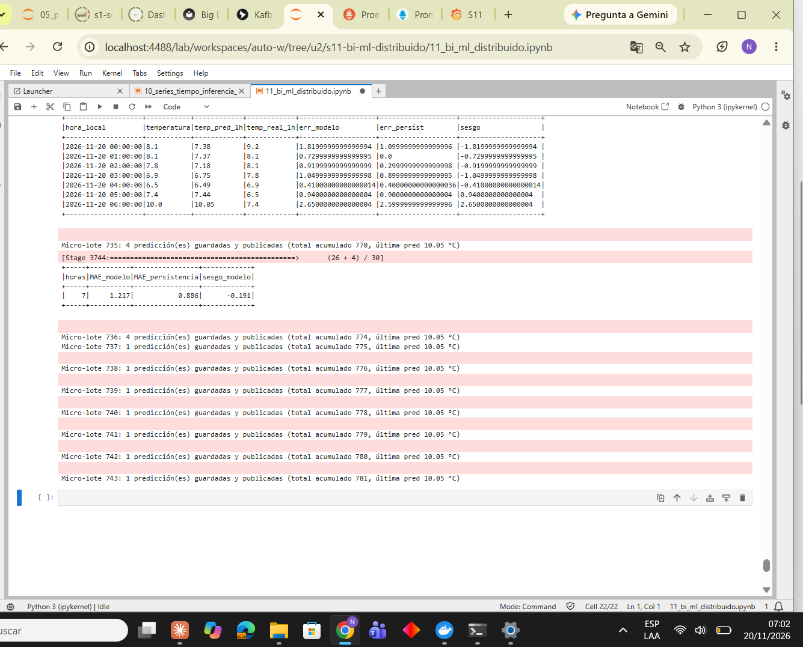
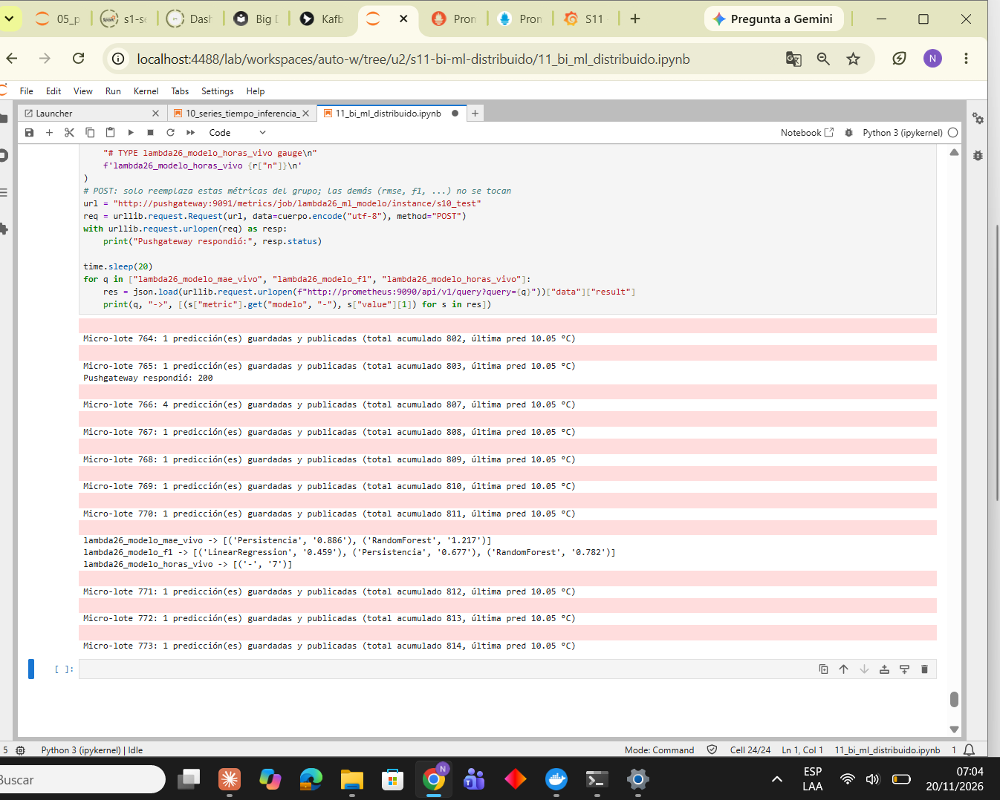
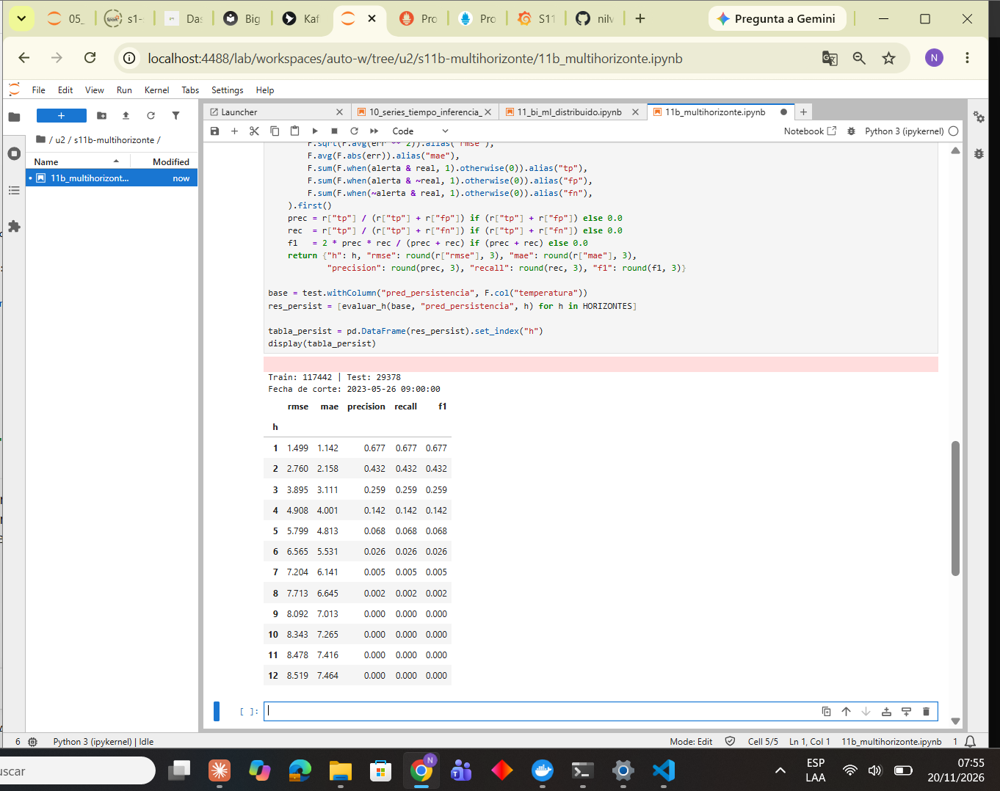
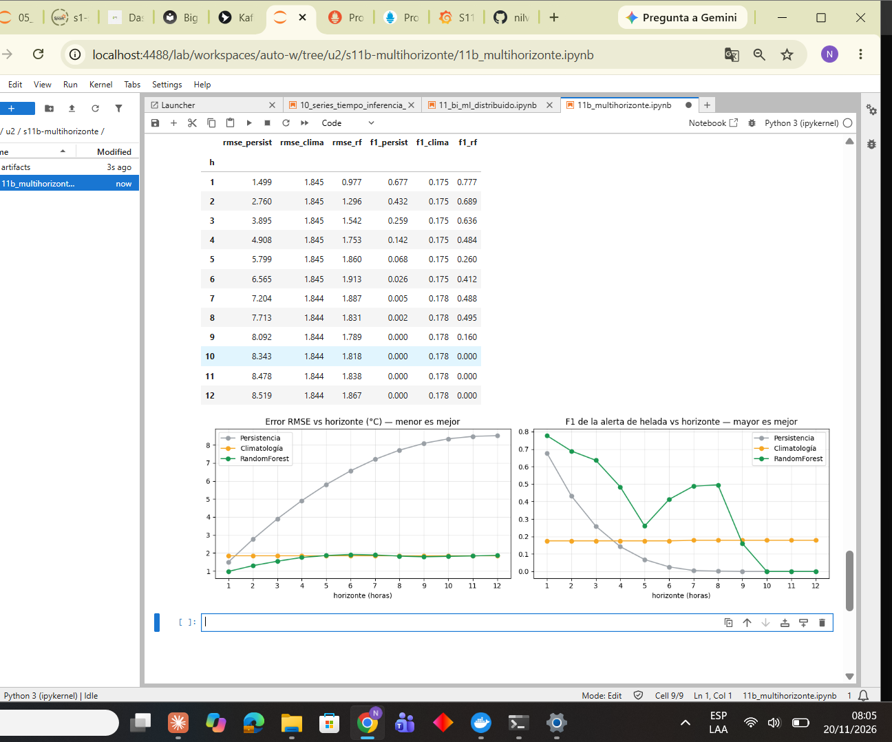

# Evidencias

Capturas del 20/11/2026, con el reloj del sistema y el perfil visibles. Cada una respalda un criterio de la rúbrica de la Unidad II.

## Tablero en Grafana (criterios 4, 6 y 7)

<figure markdown>
  
  <figcaption>Tablero «S11 - BI/ML heladas Juliaca» (carpeta Proyecto Sello U2): las tres preguntas arriba y la fila A, «¿Hay riesgo de helada ahora?», con datos en vivo.</figcaption>
</figure>

<figure markdown>
  
  <figcaption>Fila F del tablero: error y F1 según las horas de anticipación, para persistencia, climatología y RandomForest.</figcaption>
</figure>

## Prometheus y Pushgateway: las métricas llegan en vivo (criterios 4 y 6)

<figure markdown>
  
  <figcaption>Prometheus → Target health: kafka-exporter, prometheus y pushgateway en <b>UP</b>, con el último scrape de pocos segundos.</figcaption>
</figure>

<figure markdown>
  
  <figcaption>Pushgateway con los 4 grupos de métricas: histórico, predicción en vivo, métricas del modelo y KPIs del flujo.</figcaption>
</figure>

=== "06:56 · 686"

    

=== "06:57 · 698"

    

El contador `lambda26_ml_predicciones_total` subió de **686** a **698** en un minuto: los datos llegan en tiempo real.

## Auditoría del modelo en producción (criterio 7)

<figure markdown>
  
  <figcaption>Una lectura por hora (7 horas): MAE del RandomForest 1.217 °C frente a 0.886 °C de la persistencia; sesgo medio −0.191 °C.</figcaption>
</figure>

<figure markdown>
  
  <figcaption>El MAE en vivo se publica en Prometheus con los valores calculados (RandomForest 1.217, Persistencia 0.886) y el F1 de la prueba queda intacto.</figcaption>
</figure>

## Horizonte de predicción de 1 a 12 horas (criterio 7)

<figure markdown>
  
  <figcaption>Línea base de persistencia: el RMSE crece de 1.5 a 8.5 °C y el F1 cae a 0 desde las 9 h.</figcaption>
</figure>

<figure markdown>
  
  <figcaption>Persistencia, climatología y RandomForest en RMSE y F1 por horizonte.</figcaption>
</figure>
