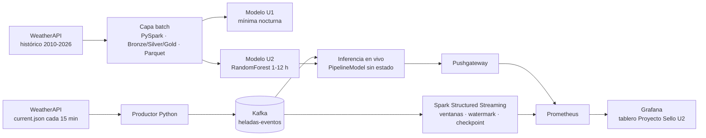

# Dominio y arquitectura

## Dominio

Meteorología aplicada a la agricultura y la gestión de riesgo en Juliaca. Las heladas nocturnas afectan cultivos como papa, quinua y cebada; cubrirlos a tiempo cuesta mucho menos que perderlos.

- **Variable de interés:** heladas (temperatura mínima ≤ 0 °C).
- **Fuente:** WeatherAPI (histórico por hora y lectura actual `current.json`).
- **Corte de datos:** nada posterior al 1 de octubre de 2026.
- **Frecuencia:** el histórico de la API existe solo por hora. El modelo se entrena y evalúa a frecuencia horaria; en streaming llegan lecturas cada 15 minutos.

## Arquitectura Lambda

Se eligió Lambda porque el problema necesita las dos cosas: el **histórico** para aprender la estacionalidad (batch) y la **lectura en vivo** para avisar con anticipación (streaming).

## Componentes

| Componente | Función en el proyecto |
|---|---|
| Kafka (`heladas-eventos`, 3 particiones, key = ciudad) | Transporte de las lecturas de clima en tiempo real |
| Kafka UI y kafka-exporter | Inspección de mensajes y métricas de infraestructura |
| Spark / PySpark 4.2 | ETL batch, streaming estructurado y MLlib |
| Parquet | Capas Bronze, Silver y Gold, y salidas de predicciones |
| Prometheus + Pushgateway | Métricas de la inferencia en vivo (el job de Spark no termina) |
| Grafana | Tablero único con KPIs y predicción |
| Docker Compose | Todos los servicios locales en la red `lambda26-kafka-net` |

## Puertos locales

| Servicio | URL |
|---|---|
| Jupyter (PySpark) | `http://localhost:4488` |
| Kafka UI | `http://localhost:48085` |
| Prometheus | `http://localhost:49090` |
| Pushgateway | `http://localhost:49091` |
| Grafana | `http://localhost:43000` |
