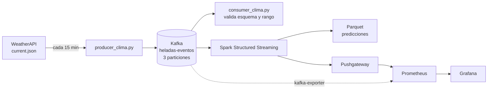

# 1. Arquitectura y contrato

## Arquitectura de la Unidad II

El pipeline es la capa speed de la arquitectura Lambda: lecturas reales de WeatherAPI entran por Kafka, Spark las procesa y las puntúa con el modelo entrenado en batch, y los resultados llegan a Grafana vía Pushgateway y Prometheus.



## Componentes

| Componente | Función en el proyecto |
|---|---|
| Kafka (`heladas-eventos`, 3 particiones, key = ciudad) | Transporte de las lecturas de clima en tiempo real |
| Kafka UI y kafka-exporter | Inspección de mensajes y métricas de infraestructura |
| Spark / PySpark 4.2 | Streaming estructurado, inferencia y MLlib |
| Parquet | Salidas de predicciones y observabilidad |
| Prometheus + Pushgateway | Métricas de la inferencia en vivo (el job de Spark no termina) |
| Grafana | Tablero único con KPIs y predicción |
| Docker Compose | Todos los servicios locales en la red `lambda26-kafka-net` |

| Servicio | URL local |
|---|---|
| Jupyter (PySpark) | `http://localhost:4488` |
| Kafka UI | `http://localhost:48085` |
| Prometheus | `http://localhost:49090` |
| Pushgateway | `http://localhost:49091` |
| Grafana | `http://localhost:43000` |

## Contrato del evento `clima.lectura`

Tópico `heladas-eventos`, 3 particiones, `key = ciudad`.

```json
{
  "tipoEvento": "clima.lectura",
  "ciudad": "Juliaca",
  "temperatura": 10.2,
  "puntoRocio": 5.9,
  "humedad": 75,
  "nubosidad": 74,
  "origen": "weatherapi",
  "observadoEn": 1795144500000,
  "timestamp": 1795145208962
}
```

| Campo | Tipo | Descripción |
|---|---|---|
| `tipoEvento` | string | Nombre del evento publicado |
| `ciudad` | string | Ciudad consultada; también es la `key` de Kafka |
| `temperatura` | number | °C (`temp_c` de la API) |
| `puntoRocio` | number | °C (`dewpoint_c`) |
| `humedad` | number | % (`humidity`) |
| `nubosidad` | number | % (`cloud`) |
| `origen` | string | `"weatherapi"` |
| `observadoEn` | number | Hora en que la API midió (epoch ms, UTC). Es el **tiempo del evento** |
| `timestamp` | number | Hora en que el productor publicó (epoch ms) |

!!! note "Dos marcas de tiempo"
    La API actualiza su observación cada ~15 minutos y el productor puede publicar más seguido. `observadoEn` (cuándo midió la API) permite deduplicar y definir ventanas; `timestamp` (cuándo se publicó) permite medir la latencia del pipeline.
