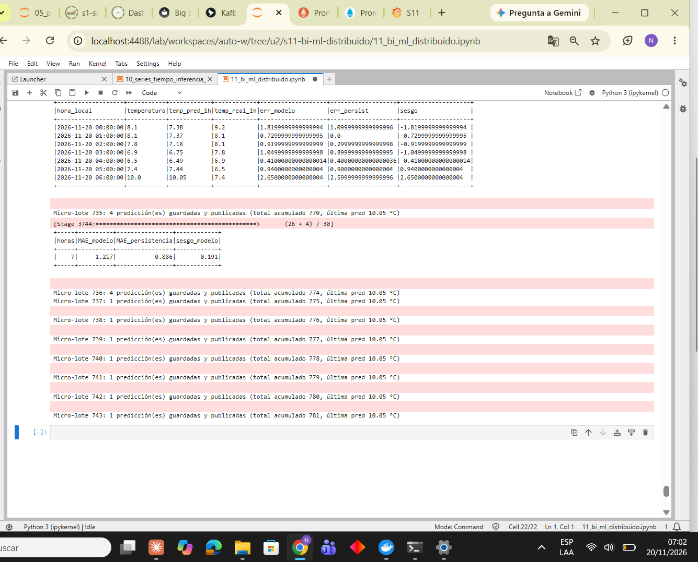

# 6. BI/ML en Grafana

Notebook: `pyspark/sesiones/u2/s11-bi-ml-distribuido/11_bi_ml_distribuido.ipynb`.

## Parte A (batch): KPIs del flujo

Sobre el Parquet de observabilidad de S9 (261 eventos) se calculan KPIs de **negocio** del flujo, publicados una vez en Pushgateway:

| KPI | Valor |
|---|---|
| Eventos procesados | 261 |
| Ratio de eventos válidos | 1.0 |
| Latencia promedio | 92 327 ms (inflada por un backlog) |
| Latencia mediana | 4 362 ms (régimen normal) |

El ratio de válidos es un KPI de **negocio**: solo se puede calcular con las reglas del dominio. A diferencia de las métricas de infraestructura (Kafka) y de aplicación (latencia por evento).

## Parte B (en vivo): el modelo de S10 sobre Kafka

El `PipelineModel` de S10 se recarga **sin reentrenar** y se aplica sobre `heladas-eventos` (`startingOffsets = latest`). En cada micro-lote (`foreachBatch`) se guarda la predicción en Parquet y se publica en Pushgateway la última lectura: temperatura real, predicción a 1 h, alerta de helada, instante del último evento y contador acumulado de predicciones.

!!! success "Prueba de que es en vivo"
    El contador `lambda26_ml_predicciones_total` consultado en Prometheus subió de **686** (06:56) a **698** (06:57) en un minuto. Prometheus recoge del Pushgateway cada 15 s (target `pushgateway` en `UP`). Capturas en [7. Tableros](tableros.md#prometheus-y-pushgateway-las-metricas-llegan-en-vivo).

!!! warning "Pushgateway: un atajo, no la forma recomendada"
    Prometheus funciona por *pull* y Pushgateway está pensado para jobs que **terminan**. Aquí se usa con un job continuo por simplicidad: si el productor se detiene, el último valor queda **congelado** en el Pushgateway y Prometheus lo seguiría mostrando como vigente. La alternativa recomendada es exponer un endpoint `/metrics` desde la aplicación. Para detectar el congelamiento se publica `lambda26_ml_ultimo_evento_ts` y el tablero muestra la *edad del último dato*.

## Auditoría del error en producción

Se juntaron las predicciones guardadas por S10 y S11, se quitaron las lecturas repetidas y se comparó cada predicción a 1 h con la lectura real una hora después. Con **una lectura por hora** (7 horas distintas):

| | MAE (°C) |
|---|---|
| RandomForest | 1.217 |
| Persistencia | 0.886 |
| Sesgo medio del modelo | −0.191 |

**Lectura honesta.** En la prueba histórica (29 377 horas) el RandomForest gana (0.730 frente a 1.142); en estas 7 horas de una sola noche cálida y nublada perdió. El modelo aprendió que de madrugada la temperatura baja y esa noche no ocurrió; a las 06:00 la temperatura cayó 2.6 °C de golpe y ninguno de los dos lo anticipó. **No es concluyente** (muestra muy corta y valores consecutivos parecidos), pero demuestra que el error medido en producción puede diferir del de la prueba, y por eso el sistema mide su error en vivo. El MAE en vivo del tablero se publica con estos valores calculados, no con valores escritos a mano.

