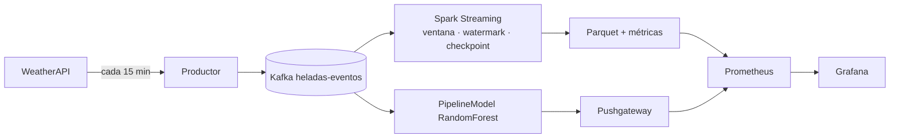

# Unidad II · Pipeline en tiempo real (S6-S11)

Producto: pipeline Big Data en tiempo real que procesa eventos, produce resultados analíticos, expone métricas operativas y prepara resultados para BI/ML distribuido.

!!! question "Pregunta de la Unidad II"
    ¿Se puede predecir la temperatura de Juliaca con 1 hora de anticipación y avisar si habrá helada (≤ 0 °C), mejor que simplemente asumir que "la próxima hora será igual que ahora"?

## Del sensor al tablero

## Rúbrica de la Unidad II y dónde está la evidencia

| # | Criterio (peso) | Dónde se demuestra |
|---|---|---|
| 1 | Ingesta de eventos empresariales por Kafka (12 %) | [S6-S7 · Ingesta](ingesta-kafka.md) |
| 2 | Ingesta de eventos IoT/sensores (10 %) | [S6-S7 · Ingesta](ingesta-kafka.md) |
| 3 | Streaming: ventanas, watermarking, checkpointing (14 %) | [S8 · Streaming](streaming-spark.md) |
| 4 | Observabilidad con métricas y tableros (12 %) | [S9 · Observabilidad](observabilidad-costos.md) y fila C del [tablero](bi-ml-tablero.md) |
| 5 | Estimación de costos y criterios de escalado (8 %) | [S9 · Costos](observabilidad-costos.md#estimacion-de-costos-y-plan-de-escalado) |
| 6 | Salidas BI/ML distribuidas (12 %) | [S11 · Tablero](bi-ml-tablero.md) |
| 7 | Series de tiempo validadas e integradas al tablero (12 %) | [S10](series-tiempo.md), [S11b](multihorizonte.md) |
| 8 | Sustentación (20 %) | [Sustentación](../sustentacion.md) |

## Notebooks de la unidad

| Sesión | Notebook |
|---|---|
| S8 | `pyspark/sesiones/u2/s08-streaming-estructurado/` |
| S9 | `pyspark/sesiones/u2/s09-observabilidad-pipeline/09_observabilidad_pipeline_grafana_costos.ipynb` |
| S10 | `pyspark/sesiones/u2/s10-series-tiempo-inferencia-streaming/10_series_tiempo_inferencia_streaming.ipynb` |
| S11 | `pyspark/sesiones/u2/s11-bi-ml-distribuido/11_bi_ml_distribuido.ipynb` |
| S11b | `pyspark/sesiones/u2/s11b-multihorizonte/11b_multihorizonte.ipynb` |
