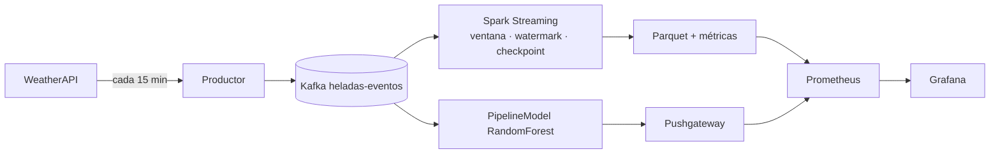

# Unidad II · Pipeline en tiempo real

UNIDAD II · KAFKA · SPARK · OBSERVABILIDAD · SERIES DE TIEMPO

*Producto de la Unidad II del equipo **BIG IMPACT** (Big Data, UPeU 2026-2).*

<table class="cover-table">
<tr><td>Equipo</td><td>10 · BIG IMPACT</td></tr>
<tr><td>Integrante</td><td>Salcca Aquino, Nilver</td></tr>
<tr><td>Código</td><td><a href="https://github.com/nilver987/big_data_proyecto-sello/tree/main/pyspark/sesiones/u2">github.com/nilver987/big_data_proyecto-sello · pyspark/sesiones/u2</a></td></tr>
<tr><td>Fuente de datos</td><td>WeatherAPI con lecturas reales de Juliaca</td></tr>
</table>

## Pregunta de la Unidad II

!!! question "Pregunta central"
    ¿Se puede predecir la temperatura de Juliaca con 1 hora de anticipación y avisar si habrá helada (≤ 0 °C), mejor que simplemente asumir que "la próxima hora será igual que ahora"?

## Del sensor al tablero

## Rúbrica de la Unidad II y dónde está la evidencia

| # | Criterio (peso) | Dónde se demuestra |
|---|---|---|
| 1 | Ingesta de eventos empresariales por Kafka (12 %) | [2. Ingesta con Kafka](ingesta-kafka.md) |
| 2 | Ingesta de eventos IoT/sensores (10 %) | [1. Arquitectura y contrato](arquitectura.md), [2. Ingesta con Kafka](ingesta-kafka.md) |
| 3 | Streaming: ventanas, watermarking, checkpointing (14 %) | [3. Streaming con Spark](streaming-spark.md) |
| 4 | Observabilidad con métricas y tableros (12 %) | [4. Observabilidad y alertas](observabilidad.md) y [7. Tableros](tableros.md) |
| 5 | Estimación de costos y criterios de escalado (8 %) | [5. Costos y escalado](costos-escalado.md) |
| 6 | Salidas BI/ML distribuidas (12 %) | [6. BI/ML en Grafana](bi-ml.md) y [7. Tableros](tableros.md) |
| 7 | Series de tiempo validadas e integradas al tablero (12 %) | [8. Series de tiempo](series-tiempo.md), [9. ¿Hasta cuántas horas?](multihorizonte.md) |
| 8 | Sustentación (20 %) | [11. Sustentación](sustentacion.md) |

## Notebooks de la unidad

| Sesión | Notebook |
|---|---|
| S8 | `pyspark/sesiones/u2/s08-streaming-estructurado/` |
| S9 | `pyspark/sesiones/u2/s09-observabilidad-pipeline/09_observabilidad_pipeline_grafana_costos.ipynb` |
| S10 | `pyspark/sesiones/u2/s10-series-tiempo-inferencia-streaming/10_series_tiempo_inferencia_streaming.ipynb` |
| S11 | `pyspark/sesiones/u2/s11-bi-ml-distribuido/11_bi_ml_distribuido.ipynb` |
| S11b | `pyspark/sesiones/u2/s11b-multihorizonte/11b_multihorizonte.ipynb` |
