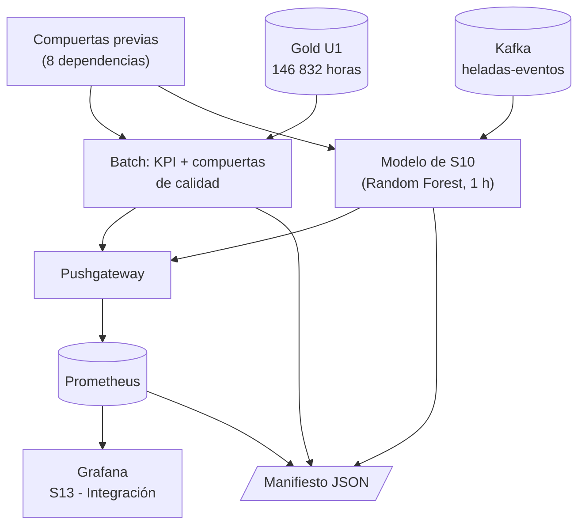

# Unidad III · Producto Final

UNIDAD III · INTEGRACIÓN · DATAOPS · HARDENING · DEMO

*Producto Final del curso: el sistema de las Unidades I y II, integrado, endurecido, documentado y defendido. Equipo **BIG IMPACT** (Big Data, UPeU 2026-2).*

<table class="cover-table">
<tr><td>Proyecto</td><td>Escudo Andino · anticipación de heladas en Juliaca</td></tr>
<tr><td>Integrante</td><td>Salcca Aquino, Nilver</td></tr>
<tr><td>Código</td><td><a href="https://github.com/nilver987/big_data_proyecto-sello/tree/main/pyspark/sesiones/u3">github.com/nilver987/big_data_proyecto-sello · pyspark/sesiones/u3</a></td></tr>
<tr><td>Notebooks</td><td>S13 <code>13_integracion_dataops.ipynb</code> · S14 <code>14_revision_hardening.ipynb</code></td></tr>
</table>

## Qué agrega la Unidad III

La Unidad III **no agrega componentes nuevos**: ensambla lo construido (batch, streaming, modelo, observabilidad) en una sola ejecución verificable y la endurece.

## Rúbrica de la Unidad III y dónde está la evidencia

| # | Criterio (peso) | Dónde se demuestra |
|---|---|---|
| 1 | Integración end-to-end de batch, streaming y BI/ML (20 %) | [Integración y DataOps](integracion-dataops.md) |
| 2 | Prácticas DataOps/DevOps (15 %) | [Integración y DataOps](integracion-dataops.md), [Hardening](hardening.md) |
| 3 | Documentación operativa completa (15 %) | [Instalación y ejecución](ejecucion.md) y esta documentación |
| 4 | Hardening y revisión técnica final (10 %) | [Hardening y revisión técnica](hardening.md) |
| 5 | Demo reproducible (15 %) | [Demo end-to-end](ejecucion.md#demo-end-to-end) |
| 6 | Sustentación con evidencias, métricas y valor (25 %) | [Sustentación y trazabilidad](sustentacion.md) |

## Navegación de la unidad

1. [Instalación y ejecución](ejecucion.md) · requisitos, comandos y demo
2. [Integración y DataOps](integracion-dataops.md) · S13: compuertas, KPI, streaming, métricas y manifiesto
3. [Hardening y revisión técnica](hardening.md) · S14: lista de comprobación, correcciones, no regresión y riesgos
4. [Sustentación y trazabilidad](sustentacion.md) · matriz, aporte individual, repositorio y preguntas
